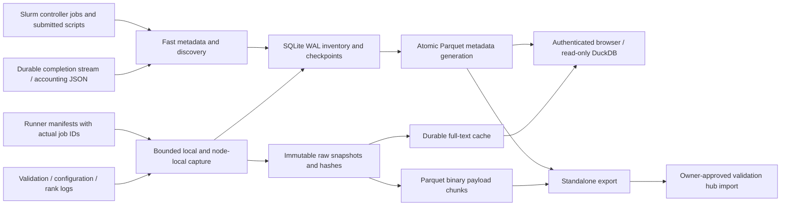

# Slurm Parquet evidence lake: customer-agnostic implementation handoff

Version 2026-10-07. Audience: customer cluster owners, validation engineers and implementation agents. This guide describes the executable configurable implementation supplied in `app/`, its exact data contract, how to install it from scratch, and how to validate the deployment. `private intake reference (excluded from this repository)` preserves the original operating implementation; its hardcoded site paths, single active-run integration and NVIS authorization must not be transplanted unchanged.

## 1. Intended result and acceptance boundary

The result is a persistent local evidence lake that continuously captures scheduler activity and approved job artifacts, preserves raw provenance, publishes queryable Parquet tables, indexes raw text, exposes an authenticated browser and produces standalone exports for a validation hub. The service resumes checkpoints after process restart and starts automatically after the persistent filesystem returns at boot.

“Capture all Slurm data” is an integration requirement, not something Slurm guarantees through stdout alone. Commission an explicit source inventory: scheduler jobs and steps, submitted batch scripts, terminal records, allocation/configuration, user stdout/stderr, per-rank logs, validation logs/results, generated launch configuration and external telemetry references. Each source needs a retention window, access identity, job association, capture adapter and completeness measure. The supplied core covers scheduler job metadata and configured files. The optional accounting adapter retains available SlurmDBD jobs/steps JSON. Other formats and lifecycle hooks require customer-specific adapters described here.

Do not label an indexed job successful without terminal scheduler/runner evidence. Do not call every indexed ID a complete archive. Historical files removed before collection cannot be recovered by installing Parquet. Do not treat a generic NCCL validation pass as training success or hardware qualification.

### Commissioning evidence required

- Actual cluster/site/epoch identity, persistent root and storage capacity.
- All configured services/timers installed and enabled, mount ordering verified.
- Successful repeated capture of a running job and terminal capture after completion.
- Actual sbatch script captured for a batch job; interactive allocation explicitly marked without one.
- Local and node-local artifact capture with exact host/job/source identity.
- Validation/configuration association from a real job ID rather than timestamps.
- Canonical metrics plus raw source provenance and explicit unsupported parser formats.
- Zero unexplained open collection errors; documented inaccessible/deferred sources remain visible.
- Authentication denial for anonymous/invalid requests and successful approved access.
- Process restart, checkpoint reopen, interrupted-index recovery and raw checksum reconstruction.
- Export queried and reconstructed independently of the checkpoint database.
- Reboot result explicitly marked tested or untested, with an approved test window if required.

## 2. Architecture and source flow



The durable state is SQLite plus immutable payloads. SQLite is a local capture journal, not the hub interchange format. `lake/current` points atomically to a complete published generation. Payloads retain raw bytes, optionally redacted. Search is a rebuildable SQLite FTS acceleration cache. DuckDB queries the published Parquet tables; the browser materializes only approved tables and disables external access before user SQL.

A poll is not a synchronous Slurm epilog. Capture jobs quickly while Slurm retains scripts, and persist terminal metadata independently. Runner registration supplies nonstandard artifact paths. Avoid slow SSH or database work in scheduler lifecycle hooks: hooks should enqueue a small durable manifest, then exit. Collection proceeds asynchronously.

## 3. Deliverables and provenance

`app/` is a configurable adaptation of a deployed collector. It removes site identity, makes source roots/Slurm paths explicit, discovers multiple jobs, replaces site login integration with a generic authenticated gateway token, bounds remote reads and provides an optional accounting adapter. Its fixture validation is distinct from production commissioning.

The original deployed implementation and site verification receipts remain in the private intake workspace. They are excluded from the repository and bundle. Only new isolated test receipts describe validation of this revision. Source packaging does not constitute a controller reboot test or large-customer scaling test.

`tools/render_deployment.py` emits source, a concrete non-secret `cluster.json`, 13 systemd units and a deployment plan. It does not create an account, install credentials, edit Slurm, activate a service or upload evidence. Rendering into an empty directory preserves older releases.

## 4. Required discovery before installation

Record these inputs in a deployment worksheet. Proceed with independent checks when an input is missing; do not invent an access identity or bypass host verification.

| Input | Required decision/evidence |
|---|---|
| Cluster scope | ClusterName, site, controller/federation scope and epoch/job-ID reset policy |
| Scheduler | Installed Slurm version, CLI paths, slurmctld unit name, partition/account visibility |
| Job retention | MinJobAge, controller log rotation and existing completion/accounting backend |
| Historical accounting | sacct/SlurmDBD availability, permissions, UTC query support and supported JSON schema |
| Storage | Persistent mount, filesystem type, free capacity, IOPS, backups and owner |
| Collection user | Dedicated service account, permitted users/jobs, readable source directories |
| Compute access | Approved SSH user/key/certificate, independently verified host keys and Python interpreter |
| Artifact layout | Shared versus node-local roots, per-rank naming, stdout/stderr templates, generated configurations |
| Validation runners | Manifest writer, real job-ID propagation, validation schema and terminal semantics |
| Authentication | Customer SSO gateway, reader groups, TLS virtual host, audit policy |
| Data policy | Excluded datasets/images/secrets, retention, redaction and permitted export destination |
| Fleet size | Concurrent jobs, hosts per allocation, log sizes/rate and capture latency budget |
| Recovery | Backup store, recovery owner, approved process failure test and possible reboot window |

Use the existing customer's scheduler permissions. A dedicated read-only account might see only its own jobs or scripts under Slurm privacy settings. Customer-authorized read visibility must match the promised scope; lake installation does not confer that permission.

Do not reboot nodes, reset GPUs, change routes or alter Slurm node state to commission an evidence collector. Do not overwrite an existing SlurmDBD or JobComp setup. Preserve existing logs and configuration before any owner-approved scheduler change.

## 5. Runtime and dependencies

The reference used Python 3.12 and dependency versions listed in `app/requirements.lock`. Install this exact closure into a separate virtual environment, or review and test a documented replacement lock for the customer's supported platform. Python dependencies are not bundled wheels. Offline deployments must download approved wheels for the destination CPU architecture/Python ABI ahead of time and include checksums and dependency license notices.

Linux with systemd and a local persistent filesystem is the supplied deployment target. Slurm CLI output, sacct JSON, filesystem ACLs, SSH identity and logging vary by customer and Slurm release. Test the installed version; do not silently assume the reference Slurm version.

Compute nodes need Python 3 for the bounded remote inventory/read helper. They do not need DuckDB, PyArrow, Flask or the full lake environment. If remote Python is unavailable, implement a reviewed binary-safe node agent/spool adapter rather than relying on shell globbing or dropping host coverage.

## 6. Configuration contract

Copy `examples/cluster.example.json`. Replace every illustrative identity/path. Keep secrets out of JSON; settings store credential file paths only.

| Key | Meaning and commissioning rule |
|---|---|
| root | Persistent local lake root; isolated per cluster and job-ID epoch |
| cluster/site/epoch | Export namespace; meaningful, stable, non-secret identifiers |
| slurm_bin | Directory containing the customer's Slurm binaries |
| service_user/service_group | Dedicated identity with approved read rights |
| slurm_service | Actual controller unit; ordering only, not permission to restart it |
| controller_log/completion_log | Existing or owner-provisioned readable durable sources |
| manifest_dirs | Ordered manifest roots; discovery first, trusted runner registration last |
| local_roots | Explicit local validation/archive roots; never the whole filesystem |
| remote_allowed_roots | Exact permitted persistent scratch/run roots; checked remotely after symlink resolution |
| experiment_templates | Optional run-root templates using `{job_id}`; empty until verified |
| ssh_user/ssh_identity_file/ssh_known_hosts | Approved compute identity and strict independent host verification |
| browser_port/browser_auth_file | Loopback port and opaque gateway token file |
| first_job_id | First ID in this lake epoch; use 1 only when reconciling from Job1 is intended |
| max_gap_span | Guard against expanding an enormous sparse numeric ID span |
| max_jobs_per_live_pass | Fair queue selection budget; default 16 |
| remote_manifest_limit | Host cap per job; default 128, larger allocations require reviewed sharding |
| remote_capture_timeout_seconds | Entire per-host read timeout; default 120 seconds |
| max_remote_files | Per-host inventory cap; default 2,000, overflow explicitly recorded |
| max_remote_batch_bytes | Per-host read budget; default 32 MiB per pass |
| freshness_budget_seconds | Monitoring budgets, measured independently for metadata/live/publication/search |
| accounting_enabled | Enable available sacct JSON evidence only after compatibility/access test |
| accounting_lookback_hours | Overlap query window, default 48h; long outages require historical backfill |

Manifests are merged by numeric job ID inside one cluster/epoch root. The source does not implement federation-wide compound IDs or array-task joins. A scalar controller JobId can coexist with ArrayJobId metadata, but array task identity and heterogeneous component/step coverage need explicit verification/adapters. Job IDs can be reused after resets; start a new epoch/root. Hub joins must include cluster and epoch. Never merge two customers into the same bare numeric namespace.

## 7. Filesystem layout and recovery ownership

```text
<root>/
  cluster.json                 non-secret rendered configuration
  app/                         installed source and README
  venv/                        isolated dependency environment
  state/
    index.sqlite               inventory, latest-source versions, metrics and error ledger
    index.sqlite-wal/-shm      active transactional files; preserve via SQLite backup API
    job-manifests/             generic scheduler-discovered manifests
    runner-manifests/          explicitly registered workload/validation manifests
    live-queue.json            fair live job attempt timestamps
    remote-backfill.json       fair historical job attempt timestamps
    search.sqlite              rebuildable FTS cache/checkpoints
    *-health.json              independent collection/publication freshness
    *.lock                     scanner/publication advisory locks
  raw/<prefix>/<hash>.gz       immutable captured/redacted raw snapshots
  lake/
    generation-<timestamp>/    complete published metadata tables and manifest
    current                    atomic symlink to current complete generation
    payloads/<hash>.parquet    binary raw chunks, immutable and independently readable
  export/                      standalone archives and their SHA256 files
```

The root must live on persistence that survives reboot/reprovisioning. A directory under `/tmp`, ephemeral container root or disposable overlay is insufficient. SQLite WAL needs local filesystem locking semantics; do not put the active checkpoint on a filesystem that cannot support them reliably. For HA, keep one writer per lake/shard and use tested fencing/backup, not competing controller collectors writing one checkpoint.

All collection processes use restrictive umask. Protect the root as 0700 and configure authorized team access through the gateway/export workflow. The package does not automatically delete raw evidence. It retains two metadata generations; raw versions and Parquet payloads continue growing.

## 8. Fresh deployment procedure

The following example uses the generic identifiers in the supplied example. Substitute the reviewed config values before execution. These commands are for a new target deployment, not the existing source cluster. Account/ACL/Slurm/gateway steps are owner-managed infrastructure changes.

### 8.1 Review and verify the package

```sh
sha256sum -c SHA256SUMS.txt
mkdir parquet-hook-review
# Inspect member names first; extract the supplied source bundle into this review directory.
tar -tzf parquet-hook-operator-kit.tar.gz
tar -xzf parquet-hook-operator-kit.tar.gz -C parquet-hook-review
cd parquet-hook-review
python3 tools/verify_package.py .
# This verifies every recorded payload member and rejects unexpected source files.
```

A checksum establishes identity against the handoff, not operating authorization. Review source, dependencies, local roots, allowlists and systemd units. Do not extract a source archive into `/`.

### 8.2 Establish the service identity and persistent root

Provision the customer's approved service identity; avoid automatically creating a new privileged scheduler administrator. Example for a dedicated Unix service account where customer policy allows it:

```sh
sudo useradd --system --create-home --home-dir /var/lib/slurm-evidence-user --shell /usr/sbin/nologin slurm-evidence
sudo install -d -o slurm-evidence -g slurm-evidence -m 0700 /var/lib/slurm-evidence/example-slurm/initial
```

Grant directory traversal and file-read ACLs to the approved controller logs, completion log and local validation roots. Do not grant unrestricted sudo, read every home directory or make private logs world-readable. Source permissions must survive log rotation; configure owner/group/default ACL and rotation settings accordingly.

For compute access, provision an approved dedicated read identity or constrained helper. The reference used a trusted site identity; that privilege level is not a generic requirement. `ssh_user` must be able to read the configured files on the correct allocated hosts. Generate no new cluster trust based on an unverified SSH prompt.

### 8.3 Render the customer deployment

```sh
cp examples/cluster.example.json customer-cluster.json
# Edit according to the discovery worksheet.
python3.12 tools/render_deployment.py --config customer-cluster.json --output rendered-customer
cat rendered-customer/deployment-plan.json
```

Inspect all rendered units and `cluster.json`. The renderer accepts safe absolute paths without whitespace/metacharacters for systemd directives. If the customer needs another path style, adapt/render/test explicitly; do not bypass the validation. Each rendered service includes `RequiresMountsFor` on the lake root.

### 8.4 Install source and dependencies

```sh
sudo install -d -o slurm-evidence -g slurm-evidence -m 0700 /var/lib/slurm-evidence/example-slurm/initial/app
sudo cp -a rendered-customer/app/. /var/lib/slurm-evidence/example-slurm/initial/app/
sudo install -o slurm-evidence -g slurm-evidence -m 0600 rendered-customer/cluster.json /var/lib/slurm-evidence/example-slurm/initial/cluster.json
sudo chown -R slurm-evidence:slurm-evidence /var/lib/slurm-evidence/example-slurm/initial/app
sudo -u slurm-evidence python3.12 -m venv /var/lib/slurm-evidence/example-slurm/initial/venv
sudo -u slurm-evidence /var/lib/slurm-evidence/example-slurm/initial/venv/bin/python -m pip install -r /var/lib/slurm-evidence/example-slurm/initial/app/requirements.lock
```

Keep Python and wheel provisioning separate from scheduler/compute images. Verify installed versions and importability. Record source and lock hashes in the deployment receipt.

### 8.5 Provision SSH and browser trust

Install the approved SSH identity and independently verified known_hosts file at the configured paths with mode 0600 and ownership/read rights for the collection user. Use strict verification. Do not disable host checking, copy passwords into config or print private keys.

Provision a randomly generated opaque gateway token of at least 32 characters into `browser_auth_file`; protect its parent and file. The automated installer writes a generated credential directly to a root-owned file without printing its value. The local authentication gateway reads the same value into a private proxy configuration or secret integration. Never include that file/value in the source handoff or customer data export.

The backend binds only loopback. It authenticates gateway requests with `X-Evidence-Token` and tunnel users through `/login` and a signed HttpOnly session cookie. Anonymous API requests are denied. Before publishing `/slurm-history/`, the gateway must enforce customer identity and authorized reader-group membership, then overwrite any client-supplied token header. The token proves trusted gateway access; it is not a replacement for end-user authorization.

`examples/nginx-evidence.conf.fragment` is an integration pattern, not a complete SSO installation. Adapt the URI, port, identity provider, auth_request implementation, TLS, timeout, logging and private token include. Review output of configuration checks so token values are not printed.

### 8.6 Configure durable terminal evidence without replacing existing accounting

Inspect existing `JobCompType`, `JobCompLoc`, `AccountingStorageType`, SlurmDBD health and `MinJobAge`. Use the existing completion/accounting feed where present. Slurm supports one configured JobComp mechanism; do not overwrite a customer plugin or SlurmDBD merely to use this example.

For an owner-approved fresh `jobcomp/filetxt` setup, create a durable completion directory/file owned by the actual Slurm daemon identity and readable by the collector. Review `examples/slurm-completion.conf.fragment`, back up the correct Slurm configuration, make the approved edit and use the customer's documented reconfiguration procedure. No daemon/controller/compute reboot is required by this guide. Confirm the next actual completed job writes a terminal row and that log rotation retains readable historical segments.

Filetxt gives completion metadata. It does not provide complete job-step resource accounting. For that scope, enable/configure the customer's existing SlurmDBD and `accounting_enabled` adapter after validating `sacct --json --allusers` with its version and read privileges. The adapter retains raw nested job/step JSON; it does not normalize every accounting resource field into metric rows. Extend normalization using a versioned schema if hub queries need CPU/RSS/energy/TRES columns.

The accounting adapter's overlap window is not a permanent cursor across unlimited outages. Backfill a wider owner-approved time range after longer outages; preserve the full raw responses and explicit range provenance. Do not infer historical completion from the absence of a job in `squeue`.

### 8.7 Run isolated tests and non-disruptive first scans

Run the supplied fixture suite from the review copy. It creates its own temporary lake and does not contact Slurm or compute hosts:

```sh
/var/lib/slurm-evidence/example-slurm/initial/venv/bin/python tests/test_portable.py
```

Then run one metadata, live, history and search pass as the real service user with the rendered configuration environment. Inspect errors after each pass before starting timers:

```sh
sudo -u slurm-evidence env SLURM_HISTORY_CONFIG=/var/lib/slurm-evidence/example-slurm/initial/cluster.json /var/lib/slurm-evidence/example-slurm/initial/venv/bin/python /var/lib/slurm-evidence/example-slurm/initial/app/metadata.py
sudo -u slurm-evidence env SLURM_HISTORY_CONFIG=/var/lib/slurm-evidence/example-slurm/initial/cluster.json /var/lib/slurm-evidence/example-slurm/initial/venv/bin/python /var/lib/slurm-evidence/example-slurm/initial/app/live.py
sudo -u slurm-evidence env SLURM_HISTORY_CONFIG=/var/lib/slurm-evidence/example-slurm/initial/cluster.json /var/lib/slurm-evidence/example-slurm/initial/venv/bin/python /var/lib/slurm-evidence/example-slurm/initial/app/history.py
sudo -u slurm-evidence env SLURM_HISTORY_CONFIG=/var/lib/slurm-evidence/example-slurm/initial/cluster.json /var/lib/slurm-evidence/example-slurm/initial/venv/bin/python /var/lib/slurm-evidence/example-slurm/initial/app/search_index.py
```

Run these serially during commissioning. Never point fixture tests at production state. A successful Python exit is insufficient: check observed IDs, scripts, files, exact bytes, coverage, errors and timestamps.

### 8.8 Install and enable generated units

```sh
sudo cp rendered-customer/systemd/* /etc/systemd/system/
sudo systemctl daemon-reload
# Verify the rendered unit files with the target host's systemd-analyze before enabling.
sudo systemctl enable --now slurm-evidence-example-slurm-initial-browser.service
sudo systemctl enable --now slurm-evidence-example-slurm-initial-metadata.timer slurm-evidence-example-slurm-initial-live.timer slurm-evidence-example-slurm-initial-scan.timer slurm-evidence-example-slurm-initial-remote-backfill.timer slurm-evidence-example-slurm-initial-search.timer slurm-evidence-example-slurm-initial-watchdog.timer
```

Substitute the names in `deployment-plan.json`. Verify each is enabled and active, then confirm health files continue advancing. Do not start multiple installations against one lake root. The watchdog is root-run with a fixed rendered unit list and only starts stopped services/timers; it does not submit jobs or change node states.

## 9. Collection stages, timing and load boundaries

| Stage | Trigger | Function |
|---|---|---|
| metadata | 5 seconds after boot, 15 seconds after prior completion | Discover all visible scheduler jobs, save exact batch scripts, retain metadata, optional accounting |
| live | 10 seconds after boot, 15 seconds after prior completion | Fair selection of active jobs and bounded artifact capture across their hosts |
| scan/publication | 15 seconds after boot, 60 seconds after prior completion | Reconcile manifests/local archives/terminal sources and publish Parquet |
| historical backfill | 120 seconds after boot, 120 seconds after prior completion | Fairly revisit up to eight terminal job/host pairs each pass |
| search | 30 seconds after boot, 5 seconds after prior completion | Incrementally index immutable payloads for up to 45 seconds per pass |
| watchdog | 30 seconds after boot, 60 seconds after prior completion | Restart stopped browser/timers from a fixed unit list |

Intervals are measured after previous service completion, not a guarantee that full-fleet reads complete every 15 seconds. Metadata is independent of SSH backfill to reduce loss of short-lived scripts. Remote concurrency defaults to two. A full allocation can take minutes. Measure publication/live lag and source coverage at actual workload size.

The generic remote helper reads only allowed roots/files, resolves symlinks before permitting a source, bounds per-file size to 64 MiB, bounds per-pass bytes and reports deferred files. Local files above 256 MiB use bounded-memory stable-file streaming; see app/streaming.py and docs/operations.md. Large source archive containers still need a reviewed adapter. Parsing above 100 MiB is explicitly deferred. Source bounds are not promises that all sizes are supported. For large remote or continuously changing logs, use durable shared final files with the included streaming adapter or implement an offset/archive adapter and test reconstruction; do not increase memory caps blindly.

Growing logs retain complete snapshot versions when captured. They do not retain every append event independently. If a file changes during reading, the checkpoint forces a revisit; a captured snapshot remains the bytes actually read. Metadata size/mtime optimization can miss changes that preserve both values; immutable terminal hash verification is the stronger final check.

Snapshotting high-rate logs repeatedly can have quadratic storage/write growth. Commission storage at realistic rate, then move large logs to append-range chunks or completion-time immutable archives. The supplied implementation is a small/medium cluster starting point, not a tested enterprise multi-million-job engine.

## 10. Artifact and validation registration

Generic scheduler discovery retains scalar job identity, expanded node list, batch host, stdout/stderr paths and raw `scontrol` metadata. It intentionally does not recurse a user's entire WorkDir. The scheduler does not know every per-rank log, config or external validation file.

Use trusted runner manifests to supply those paths. `examples/validation-job-manifest.json` is illustrative, including its PASS field; never register the example as real evidence. Populate actual values only after scheduler submission/allocation and actual validation observations.

Required manifest fields are `job_id` and explicit `nodes`. Recommended fields: cluster/epoch, workload, batch_host, experiment or experiments, log_path/stdout/stderr, GPU count, submitted/started/completed UTC timestamps, final_state, exit_code, runtime_gate with evidence reference, qualification_status and source provenance. `scontrol show hostnames` expands compact allocations. Same pathname on two compute nodes is two distinct sources.

```sh
python3 tools/write_job_manifest.py --config /var/lib/slurm-evidence/example-slurm/initial/cluster.json --input actual-job-manifest.json
```

Register before releasing the workload when the runner supports held jobs, then update terminal metadata after exit. This writer registers evidence; it never submits/releases a job. Write manifests in the controller-visible durable directory. For node-local writer hooks, forward a small manifest through the customer's approved durable queue, not an unreliable ad hoc background SSH.

Include diagnostics launched through `srun`: record `SLURM_JOB_ID`, command, allocation, exit status and rank evidence. Interactive BatchFlag=0 allocations have no submitted sbatch script; absence is expected and recorded. Keep actual srun commands in runner manifests/logs. Diagnostics unrelated to Slurm need their own experiment identity and explicit parent-job relation; do not invent a Slurm ID to force a join.

Validation JSON is captured raw and indexed when recognized fields exist. `passed/ok=true` can classify an evidence row as PASS; absence of recognized evidence means EVIDENCE/UNKNOWN. A validation row is not automatically an overall certification decision. Validate schema, rank coverage, source hashes and execution status in the hub's versioned qualification rules.

## 11. Parquet schema and source identities

| Table | Authority and interpretation |
|---|---|
| jobs | Numeric job ID within cluster/epoch, raw metadata JSON, coverage, normalized workload/model/dtype/GPU/state/time/nodes |
| artifacts | Source/version/hash, original/stored bytes, captured time, job ID, redaction flag and kind |
| metrics | Canonical current job/iteration/metric value with artifact/line provenance |
| metric_observations | Current-source observations preserved before canonical alias deduplication |
| validations | Validation artifact ID, job ID, status and recognized summary JSON |
| remote_coverage | Per-job/per-host inventory/captured count, status, timestamp and error |
| errors | Durable failed/deferred source ledger; resolved_utc distinguishes recovered entries |
| gaps | Missing numeric IDs in the configured range, explicitly not treated as success |

`artifacts.version` hashes source identity plus source content hash. `sha256` is the captured original bytes' hash; `stored_sha256` is the stored bytes after redaction. If redacted=0 they agree. If redacted=1, the original hash records provenance but original secret bytes are intentionally not exported. Per-source versions are immutable; latest-source pointers are checkpoint state.

`payloads/<stored_sha256>.parquet` has `stored_sha256`, `chunk`, `byte_offset`, and binary `data`. Concatenate ordered chunks to reconstruct stored bytes and verify the hash. Metadata exports plus payload files are standalone without SQLite/gzip sidecars.

Original metric rows retain source line/iteration/unit. Built-in training patterns recognize Megatron-style elapsed time, modeled throughput and LM loss. Arbitrary customer logs are preserved even when not parsed. Add versioned parser fixtures for other formats; unknown metrics must not become zero. `iteration_time` is milliseconds; `step_time` is printed seconds and can differ because of rounding. Modeled TFLOP/s/GPU is model-computed throughput, not DCGM utilization percentage. Loss is dimensionless.

Canonical metrics assume one logical measurement stream per job/iteration/metric. Multiple phases/ranks/repeats inside one job may need a richer key before canonicalization. `metric_observations` keeps provenance needed to diagnose collisions; full raw snapshots remain in artifacts/payloads. Do not apply the existing preference rule blindly to unrelated multi-stream jobs.

Slurm CLI queries use TZ=UTC. Raw training timestamps remain source-native, sometimes timezone-unverified. Do not relabel raw Pacific/local strings UTC. Validate accounting timezone behavior on the customer cluster and retain source timezone metadata if a hub needs normalized event correlation.

## 12. Querying and browse access

The published manifest records cluster/site/epoch, parser revision, units, source implementation hashes, coverage, errors and free space. Read it alongside tables.

```sql
SELECT job_id, workload, dtype, gpus, state, coverage FROM jobs ORDER BY job_id DESC;
SELECT job_id, source, sha256, stored_sha256, redacted FROM artifacts WHERE job_id=123;
SELECT iteration, metric, value, unit, artifact_id FROM metrics WHERE job_id=123 ORDER BY iteration, metric;
SELECT * FROM validations WHERE job_id=123;
SELECT * FROM remote_coverage WHERE job_id=123;
SELECT * FROM errors WHERE resolved_utc IS NULL;
SELECT * FROM gaps ORDER BY job_id;
```

Browser SQL allows one SELECT/WITH expression, caps rows, applies a timeout and disables external file/network access after approved tables are materialized. Direct DuckDB queries used by trusted operators are separate and can read explicit local exports. Do not expose unrestricted DuckDB filesystem access to browser users.

Full-text search uses immutable-payload FTS plus bounded fallback while indexing catches up. The browser reports indexed/searched/available coverage and request truncation; zero matches in a partial search is not proof of absence. Narrow searches by job ID. Raw downloads stream retained stored bytes. Exports are produced explicitly, not by an expensive background action on every page visit.

## 13. Restart and boot survival

The browser uses `Restart=always` with five-second delay. Collection oneshots use `Restart=on-failure`. Timers are enabled under `timers.target`; `OnBootSec` schedules fresh work after boot and `OnUnitInactiveSec` avoids overlap with the same oneshot. All rendered services require the persistent lake mount. SQLite checkpoints, durable manifests/queues and immutable raw files survive process exit.

The deployed reference has `Persistent=true` on timers. That property does not make monotonic OnBoot/OnUnitInactive timers replay every missed invocation; persistence catch-up is relevant to calendar timers. The portable renderer relies on boot triggers and source reconciliation rather than claiming missed 15-second polls are replayed. Files/metadata that expired while the collector was unavailable can still be missing.

The watchdog restarts inactive units. It does not solve a filesystem failure, a hung service, invalid configuration, read permission failure, network outage, rate limit or disk exhaustion. It does not reset systemd start-limit counters automatically. `health_check.py` is an independent freshness/error check suitable for the customer's monitoring system. Wire an external alert transport and an owner for each alert; journal/file updates alone are not notifications.

Boot survival requires source storage persistence too: recovering the lake does not recover a compute-node log that disappeared from ephemeral scratch. Make rank logs and terminal spool persistent or capture them before node teardown. Configure backup of the lake separately; reboot persistence is not protection from disk loss/ransomware.

## 14. Failure and recovery runbook

### Collector process crash or stopped timer

Check service status, journal, fresh health times and mounted root. Restart only the affected collector unit or stopped timer. Preserve SQLite/raw payloads/queues. A successful restart must advance timestamps and resume version/checkpoint behavior without duplicating canonical metrics.

### Controller unavailable / SSH timeout / missing host

Capture explicit errors and per-host coverage. Keep fast local metadata collection separate where possible. Verify management path, host identities and read permissions without changing node state or rebooting. Retry through the fair queue. Do not label inaccessible observations a GPU hardware failure or a validation pass.

### Node-local directory missing

Compare runner manifest to the actual allocation and mount layout. Same-spelling controller paths do not prove node-local content exists. Preserve all surviving hosts and mark missing hosts/files. Do not invent deleted bytes. If a manifest is wrong, append/update provenance for the correction and retain prior captured snapshots.

### Oversized/deferred files

Inspect the error ledger. Implement reviewed chunked capture or persistent final archive for those files. Increase limits only after validating memory/IO/time budgets. Keep deferral visible until exact stored bytes are captured and verified.

### SQLite lock/busy or scanner timeout

Confirm one scanner per root and expected WAL concurrency. Inspect transaction duration and disk latency. Metadata/live/historical writers share WAL state, but publication can still contend. Do not delete the database to clear a lock. Stop conflicting writers and take an online SQLite backup before recovery. Interrupted FTS work is rebuilt/revisited from immutable payloads.

### Low disk

Warning starts below 20 GiB; publication refuses below 2 GiB. Collection growth can continue until its own writes fail, so respond before hard exhaustion. Add capacity, archive approved immutable exports and apply an explicit retention policy only after verifying backup/hub durability. No automatic raw deletion is authorized by this package.

### Authentication failures

Verify the local token-file permissions and approved gateway token injection without printing values. Confirm SSO/group authorization and TLS. Do not solve a 401 by turning off backend authorization or listening on a public interface.

### Source/parser upgrade

Copy source to a reviewed release, run fixtures against preserved example logs, record parser/source hashes, then install atomically under the existing path during a controlled collector stop. Preserve checkpoint state. Reparse retained snapshots using the approved parser revision; compare metrics against archived raw logs. Do not equate a changed parser's result with a changed historical workload.

### Collector rollback

Disable the fixed watchdog first so it does not undo the maintenance stop. Stop timers and let active oneshots complete or stop them intentionally. Restore the prior reviewed source/config/venv/unit definitions, keep the lake intact and verify schema compatibility. Re-enable units/watchdog and prove freshness and checksum behavior. Rollback never changes a workload's success state or deletes its errors.

## 15. Backup and disaster recovery

For a consistent backup, quiesce collection/publication or use the SQLite online backup API for `state/index.sqlite`. Do not copy only the main SQLite file while ignoring active WAL. `tools/backup_checkpoint.py --config ACTUAL_CONFIG --output NEW_BACKUP.sqlite` uses the online backup API and verifies checkpoint integrity; it deliberately does not claim to back up payloads, manifests or credentials. Copy config, manifests/queues, immutable raw and payload files, a complete published generation/manifest and release/dependency/unit provenance. Search.sqlite is rebuildable but can be backed up with its own SQLite mechanism for faster restoration.

Record hash inventories and verify an isolated restore. A backup of SQLite without payload bytes cannot reconstruct artifacts; payloads without manifests/checkpoints can be queried but may lack recovery state. Export is a portable evidence snapshot, not a full runtime backup of the collector.

For controller HA, choose one writer per lake, persistent volume failover/fencing, stable cluster/epoch identity and a tested recovery procedure. The supplied implementation does not provide distributed locking or automatic cross-controller HA.

## 16. Commissioning and acceptance tests

First run `tests/test_portable.py`. It uses temporary local fixtures for idempotent capture, appended versions, checkpoint reopening, raw Parquet/export reconstruction, generic concurrent job discovery, authentication, restricted SQL, remote allowlists and explicit failures. Fixtures do not prove target scheduling/access/boot behavior.

Then use owner-approved existing jobs or a small approved diagnostic allocation. Do not submit a training workload solely to test collection. Suggested deterministic fixture: write a configuration JSON, stdout, stderr, validation JSON with actual job ID and per-node rank files under a persistent approved run root. Append a second stdout record, complete with known exit status and verify exact hashes against the captured final artifacts. Run one intentional validation failure and verify that it stays failed even though collection succeeds.

Check scheduler record/script capture before its retention window expires. Test BatchFlag=0 and no fabricated batch script. Test two concurrently visible jobs. Test local/shared and node-local sources. Check every expected host's inventory; `inventoried` means the specified source set was inspected, not that unknown source paths exist nowhere else.

Failure tests in an isolated commissioning lake: interrupt a collector between passes, restart, make one source temporarily unreadable, use a wrong test gateway token, add an oversized fixture, interrupt FTS, and independently verify an export. Do not crash the production scheduler. A browser process crash can be tested separately while leaving workloads untouched.

For real reboot proof, schedule an owner-approved collector-host reboot after current workloads and change policy allow it. Back up first, record enabled unit/mount/source identities, reboot only the approved host, then verify same cluster/epoch, checkpoint continuity, services/timers, fresh capture, terminal stream and preserved raw hashes. If no reboot is approved, record reboot verification as **untested**; enabled units plus process restart are narrower evidence.

Store the commissioning receipt with UTC timestamps, source/config/lock hashes, installed versions, unit enablement/status, fixture and real-job IDs, expected/recovered host/file counts, open exceptions, exported archive SHA, raw reconstruction checks and reboot result. Avoid including credentials or whole secret environments.

## 17. Validation hub export and import

Export is explicit and local. Inspect disk capacity and publication/source freshness first. Reconcile the final scheduler/runner status and actual cohorts; record unresolved gaps and errors. Coordinate publication with other writers or export during a quiet capture window. The portable exporter holds the local publication lock through archive creation, pinning its generation against concurrent local publication/retention. Other capture writers can still append checkpoints/raw snapshots; the export reflects its fixed metadata generation. The deployed reference does not hold an export-wide lease, so use a quiet publication window if exporting from that reference. Neither implementation provides a distributed lock across customer hosts.

```sh
sudo -u slurm-evidence env SLURM_HISTORY_CONFIG=/var/lib/slurm-evidence/example-slurm/initial/cluster.json /var/lib/slurm-evidence/example-slurm/initial/venv/bin/python /var/lib/slurm-evidence/example-slurm/initial/app/history.py export
```

The archive contains `tables/*.parquet`, `tables/manifest.json`, `payloads/*.parquet` and README, plus a sibling archive checksum. Extract into a review directory using safe member checks. Query with DuckDB and verify every referenced raw payload independently:

```sh
python3 tools/verify_export.py extracted-export
# Reconstruct one approved stored artifact into a local file:
python3 tools/verify_export.py extracted-export --stored-sha256 ACTUAL_STORED_SHA256 --output reconstructed.out
```

Hub import contract: namespace every job by `(cluster, cluster_epoch, job_id)` and every artifact by source/version/stored hash within the customer tenancy. Retain export SHA, export manifest, parser/source hashes, units, source paths, capture times, redaction flag and coverage/errors. Import payloads as immutable evidence, verify checksum before acknowledging durable acceptance, and retain raw provenance for independent reparse.

A hub can query normalized jobs/metrics and attach validation rules to validations/raw accounting JSON. Unknown fields/qualifications remain unknown. Do not flatten task IDs or combine different rank/repeat measurement streams silently. Preserve numerical units; compare only compatible recipe/version/scale/configuration and scoring window. Raw logs are evidence, not an official benchmark qualification by themselves.

No validation-hub API/auth/schema is assumed. Implement an owner-approved sink adapter for the real target, with idempotent import key, retry/resume receipts, per-customer permissions and retention policy. Never upload private raw data because source-code publication was authorized. This source package contains no live raw lake, customer database or credentials.

## 18. Scaling and implementation extensions

Before a very large deployment, measure jobs/day, concurrent jobs, hosts/allocation, retained bytes per job and log append rate. Track metadata lag, SSH round time, bytes/pass, scanner transaction duration, publication size/time, payload duplication, FTS catch-up and disk growth. Tune budgets based on measurements.

Shard by cluster/epoch/campaign or a stable job range and preserve compound identity. One local SQLite writer coordinator per shard avoids HA races. Use chunk/offset ingestion for growing logs, partitioned incremental Parquet metadata and object-store payloads for high volume. The current exporter rewrites metadata generations and the browser materializes tables; it is not a petabyte lakehouse catalog or unlimited SQL engine.

Large sparse job ranges need interval gaps rather than generating a row for every missing number. The supplied max-gap guard stops unbounded enumeration. Sacct overlap capture needs a persistent range cursor/backfill queue for longer history. Lifecycle/submit spool prevents missing very short jobs that begin/end between polls. Scheduling steps, federation, arrays, heterogeneous jobs, retries and GPU accounting require schema fixtures and explicit joins.

The application is not a tamper-evident ledger: local filesystem permissions and hashes detect content mismatch, but trusted administrators can replace files/hashes. If customer policy needs stronger evidence, sign export manifests, use immutable object retention and externally anchored audit records. Redaction is heuristic and cannot guarantee every secret is removed; restrict access and review export destinations.

## 19. Official reference points

Consult the installed version's local manuals first; use official documentation to resolve version differences:

- Slurm configuration, JobComp/Accounting/MinJobAge: https://slurm.schedmd.com/slurm.conf.html
- Slurm controller metadata/script operations: https://slurm.schedmd.com/scontrol.html
- Slurm accounting jobs and steps: https://slurm.schedmd.com/sacct.html
- systemd timer semantics: https://www.freedesktop.org/software/systemd/man/latest/systemd.timer.html
- systemd service restart policy: https://www.freedesktop.org/software/systemd/man/latest/systemd.service.html
- SQLite WAL and backup: https://www.sqlite.org/wal.html and https://www.sqlite.org/backup.html
- DuckDB Parquet and external-access configuration: https://duckdb.org/docs/stable/data/parquet/overview and https://duckdb.org/docs/stable/configuration/overview

These references supplement the supplied exact source and fixture evidence. They do not certify compatibility with an uninspected customer cluster.
