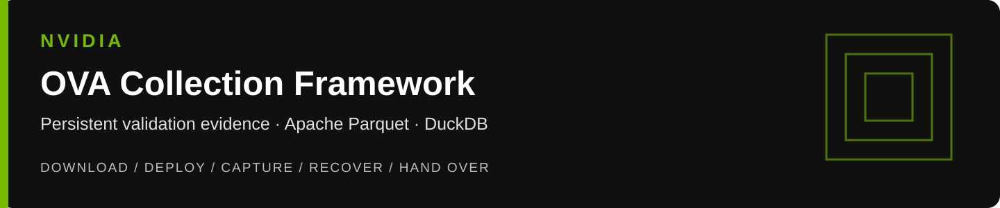
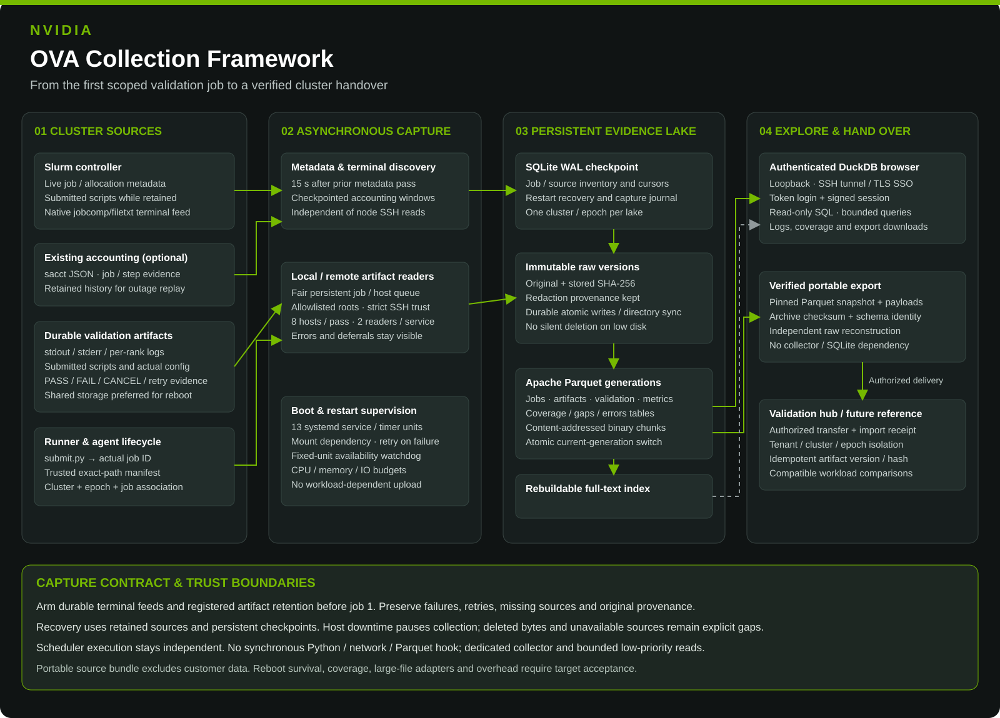

# OVA Collection Framework

**Download → configure once → deploy → capture → hand over.** A cluster agnostic deployment kit for Slurm validation evidence, Apache Parquet and an authenticated DuckDB browser. Collect job outcomes, raw logs, submitted scripts, configurations and validation results into persistent storage, then export a self-contained evidence lake for a validation hub and future cluster comparisons.



## Deploy on a new cluster

Use a dedicated collector host with Python 3.12+, systemd, persistent local storage and read access to the cluster's Slurm sources. Debian/Ubuntu with GNU utilities is the installer baseline; other Linux platforms need prerequisite adaptation. The example disables compute-node SSH reads. Compute-node access is optional when all run artifacts are on a durable shared filesystem readable by the collector.

1. Download the **`ova-collection-framework.tar.gz`** CI artifact and its checksum. Verify, inspect member paths and extract into an empty directory. The bundle contains source and docs, not dependencies or cluster data.
2. Copy `examples/cluster.example.json` to a private location outside the checkout. Replace site/cluster/epoch, source paths and narrow artifact roots. Arrange read ACLs for the collection identity; see [deployment](docs/deployment.md).
3. Run the deployment command on the designated collector host:

```sh
# Native Slurm completion feed already provisioned, or existing accounting configured:
sudo python3 tools/deploy.py apply --config /etc/ova-collection/cluster.json --output /var/tmp/ova-rendered

# Fresh standalone Slurm configuration without an existing completion plugin:
# Add this option to the same command to install Slurm's native filetxt completion feed.
# --configure-jobcomp /etc/slurm/slurm.conf --slurm-user slurm
```

The installer creates the service account and directories, installs pinned Python dependencies and 13 systemd units, generates the browser credential, checks source access as the actual collection identity, runs first scans and enables collection at boot. It refuses to overwrite an existing deployment. Use `plan` instead of `apply` for a non-privileged rendering. Each output directory must be empty. Installation errors leave evidence intact; inspect partial installation before resuming manually.

4. Follow [acceptance](docs/acceptance.md) **before releasing the first validation job**. Use the [runner wrapper](docs/hooks.md) for a durable run directory and script/config registration. Existing runners can emit the same manifest contract.
5. Open the browser through an SSH tunnel to the collector's loopback port. Sign in with the generated credential from the file named in the installation receipt. Team access can use the documented authenticated SSO proxy.

```sh
ssh -N -L 4310:127.0.0.1:4310 <authorized-user>@<collector-host>
# Visit http://127.0.0.1:4310/login
```

No site identity, host inventory, credentials, customer logs or deployed reference state is distributed. Apache Parquet is the lake file format; PyArrow writes it. The supplied browser is a Flask/Waitress application that queries Parquet with DuckDB. It does not require the separate upstream DuckDB UI extension or an external UI website.

## What “every run” requires

The capture contract is **every scoped Slurm job and every declared readable artifact**, including failed, cancelled and retried validations. Commission durable completion/accounting before job 1, retain run artifacts until verified capture, register exact config/validation paths, and reconcile against an independent scheduler inventory. Numeric IDs are not guaranteed contiguous; missing IDs are unresolved evidence, never fabricated successes.

Boot-enabled services, process restart and durable checkpoints support recovery. Collection pauses when its host or source is down; retained sources allow replay. No software can recover bytes deleted before capture or provide uninterrupted operation on a powered-off machine. This release has fixture-tested restart/recovery; target controller/compute reboot and performance acceptance remain commissioning checks.

Supported automatic identity is scalar jobs in one Slurm cluster/epoch. Arrays, federation, heterogeneous components, large files beyond the configured source limits and distributed HA need an adapter and evidence before inclusion in the promised scope. Remote snapshot capture is limited to 64 MiB per file. Local files over 256 MiB use bounded-memory stable-file streaming and incremental Parquet payload chunks; a file that changes during this read is retried. Keep large logs on durable shared storage until their final capture. Oversized remote files and changing sources that never fit the pass budget require a site adapter before complete-capture acceptance. See [coverage and resource limits](docs/operations.md).

## Documentation

| Guide | Purpose |
| --- | --- |
| [Architecture](docs/architecture.md) | Sources, persistence, trust boundaries, data model and recovery flow |
| [Deployment](docs/deployment.md) | One-command installation, private settings, storage, ACLs, offline setup and rollback |
| [Harness and hooks](docs/hooks.md) | Agent phases, submission wrapper, manifests and native Slurm plugin |
| [Operations](docs/operations.md) | Low-impact budgets, source retention, monitoring, restart and reboot recovery |
| [Acceptance](docs/acceptance.md) | Job-1 gate, short/failed jobs, exact bytes, restart, reboot and overhead evidence |
| [Handover and hub](docs/handover.md) | Portable exports, checksums, independent reconstruction and hub import contract |
| [Factory publication](docs/factory.md) | Intake, customer-data exclusion, CI gates and human-reviewed MR |
| [Agent handoff](AGENT_HANDOFF.md) | Detailed agent task and deployment receipt |
| [Implementation reference](IMPLEMENTATION_HANDOFF.md) | Detailed collector source and manual installation reference |

## Local validation

```sh
python3 -m venv /var/tmp/ova-review-venv
/var/tmp/ova-review-venv/bin/pip install -r app/requirements.lock
/var/tmp/ova-review-venv/bin/python tools/run_tests.py
/var/tmp/ova-review-venv/bin/python tools/check_repository.py
/var/tmp/ova-review-venv/bin/python -m compileall -q app tools tests
```

Run fixtures only in temporary lakes. CI tests source behavior, package integrity and unit rendering; it does not commission a customer cluster. Local exports stay local until delivery to a specific hub is authorized.
